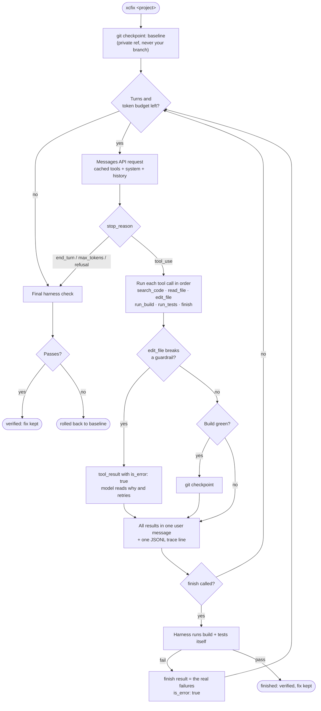

# 01 · Agent loop: xcfix

**xcfix** is an agent that fixes iOS code whose build or tests fail. Point it at a Swift package or an Xcode project and it:
- builds the project and reads the compiler errors;
- finds and edits the code;
- rebuilds and reruns the tests until everything passes, or it runs out of budget.

It's a hand-written agent loop in Python on the Claude API, with no agent framework. Narrow iOS tools, harness-side verification, git rollback, prompt caching and per-turn traces make it safe to run unattended and measurable.

The loop is built to be reused as the core of larger tools, such as an AI-driven Swift migration pipeline or a CI build-break fixer.

## Results

**15/15 runs fixed: all 5 seeded bugs, 3 runs each, at $0.015 and 21.5 seconds per run on average, $0.23 in total.**

The eval ran on 2026-10-22 with Claude Sonnet 5.5 at `medium` effort, with caching and context editing on. "Fixed" means the harness's own build and tests passed; the model's claim doesn't count.

| Bug branch | What was broken | Fixed? | Turns | Tokens | Cost | Seconds |
| --- | --- | ---: | ---: | ---: | ---: | ---: |
| `bug/type-mismatch` | `Int` passed where `String` is expected | 3/3 | 5.0 | 14,989 | $0.0082 | 19.6 |
| `bug/missing-import` | `import ListingsKit` removed; it surfaces as a closure type error, not "cannot find type" | 3/3 | 5.7 | 19,935 | $0.0150 | 22.2 |
| `bug/main-actor` | Swift 6: a `@MainActor` cache used from a nonisolated method | 3/3 | 5.0 | 15,960 | $0.0137 | 19.8 |
| `bug/renamed-api` | `listings(for:)` renamed to `loadListings(for:)`; the tests still call the old name | 3/3 | 6.0 | 22,573 | $0.0250 | 23.8 |
| `bug/failing-test` | A test expects `starRating == 0.0`; the fixture says 5.0 | 3/3 | 6.3 | 19,107 | $0.0141 | 22.2 |
| **All** | | **15/15** | **5.6** | **18,513** | **$0.0152** | **21.5** |

Turns, tokens, cost and seconds are means per run. The milestone was at least 4 of 5 bugs fixed; xcfix fixed all 5, on every run.

**Reviewing the fixes.** Every verified fix is saved in [`evals/diffs/`](evals/diffs/), and all 15 were compared with the seeded bugs:

| Branch | Fix | Verdict |
| --- | --- | --- |
| `bug/type-mismatch`, `bug/missing-import` | `String(query.adults)`; adding back `import ListingsKit` | The exact inverse of the seeded bug, in all 3 runs |
| `bug/failing-test` | The expected value changed from `0.0` to `5.0` | Exact. Changing an expected value is the case the guardrails deliberately allow; the model's summary explains that the test, not the code, was wrong |
| `bug/renamed-api` | The four test call sites moved to `loadListings(for:)` | Right: callers migrate to the renamed API |
| `bug/main-actor` | The `@MainActor` cache removed, so the formatter builds its style on every call | Builds and passes, and matches the code before the bug was seeded. **But** it drops the cache instead of making it concurrency-safe, for example behind an `OSAllocatedUnfairLock`. `Mutex` would need iOS 18 / macOS 15, and the package targets iOS 17 / macOS 14. A stricter rubric would count this as a partial fix |

**What the traces show** (15 runs, 84 turns):
- **Caching cut cost by about 65%.** The runs read 240,044 prompt tokens from the cache. At full price, the same tokens would have cost about $0.65 instead of $0.23. Every run's *first* turn already read the 2,172-token tools-and-system prefix that earlier runs had cached.
- **Output is half the bill:** $0.115 of $0.228, with cache writes at 28% and cache reads at 21%. Uncached input is practically zero (198 tokens over all runs).
- **Time is split between the model and the build.** Model 51% (about 2 s per turn), tools 36% (`swift test` 3.8 s, `swift build` 1.5 s on average), harness verification 11%.
- **Error messages drove recovery.** The only 3 tool errors, one per `bug/renamed-api` run, were `old_str occurs 2 times`. In each case the model added context and the next edit succeeded.
- **The model never called `finish` too early** (0 rejections), and no guardrail fired. Neither safety net was exercised by these bugs. Both are covered by unit tests and by scripted runs on the real repo.
- **Parallel calls were common:** 24 of 84 turns made several calls at once, such as `read_file` with `search_code`, or `edit_file` with `run_tests`.
- **Context editing never triggered.** No run came near its 30,000-token threshold, so these short runs say nothing about it.

**What to optimize next:**
- **Skip redundant verification.** When the model's own `run_tests` passed and no edit followed, the harness's final rebuild and retest repeats work it has already done, about 11% of wall time.
- **Reduce output tokens,** for example with a lower effort level, since they're half the cost. That needs a before-and-after eval.

Full tables: [`evals/results.md`](evals/results.md) · raw data: [`evals/results.json`](evals/results.json) · traces: [`evals/traces/`](evals/traces/)

## How the loop works



The model decides *what* to do next; the harness decides *whether it worked*. The model only stops when the harness's own build and tests pass, or a limit is hit, in which case the project is rolled back.

## Design decisions

1. **Six narrow tools, not a shell.**
   - **Why:** a `run_command` tool can do anything, including `rm -rf`, `git push` or reading `~/.ssh`, and it returns raw logs that cost thousands of tokens.
   - **How:** xcfix's tools can only search, read line ranges, make exact unique replacements, build, test, and finish. Every path is checked against the project root. `run_build` returns the parsed errors, never the log. That makes the tools safer, cheaper and more reliable.
2. **The harness verifies; the model never decides success.**
   - **Why:** models declare victory early.
   - **How:** `finish` is a request: the harness runs the build and tests itself, and if they fail, the failures become `finish`'s result and the loop continues. The eval's "fixed?" column is the harness's verdict, not the model's claim.
3. **Errors are part of the interface.**
   - **Why:** a precise error turns a failed call into a quick, correct retry instead of a stuck run.
   - **How:** a failed call returns `is_error: true` with a message that says what to change. For example, `old_str occurs 2 times; include more surrounding lines`, or `whitespace differs: check indentation`.
4. **Guardrails stop the model making tests pass the wrong way.**
   - **Why:** verification alone would accept a "fix" that deletes the failing test.
   - **How:** edits that delete or disable tests or assertions, add `@unchecked Sendable` or `nonisolated(unsafe)`, or add `TODO`/`FIXME` are rejected. Changing an expected value is allowed, because it's the honest fix when the test itself is wrong.
5. **Git checkpoints on a private ref, rollback on failure.**
   - **Why:** a failed run must never leave half-applied edits behind.
   - **How:** the project is snapshotted before the run and after every green build, as commits on `refs/xcfix/<run-id>`, never on your branch. A run that isn't verified is restored to the baseline, so reruns are safe in CI and in evals.
6. **Tool calls run in order, and their results come back in one message.**
   - **Why:** an edit racing a build would compile half-edited code, and splitting parallel results across messages teaches the model to stop making parallel calls.
   - **How:** the calls in one turn run one by one, and all their results go back together.
7. **The history is append-only, and caching does the rest.**
   - **Why:** the tools and system prompt are byte-identical on every request, so they can be cached with a breakpoint, and a second, moving breakpoint caches the conversation. Rewriting old turns client-side would break the cache and invalidate Sonnet 5.5's thinking blocks.
   - **How:** old build logs are cleared by the API's server-side context editing instead, and only in long runs.
8. **Every run is a trace.**
   - **Why:** "it worked" isn't enough to optimize.
   - **How:** one JSONL line per turn records the tool calls with their arguments, latency, uncached, cached and output tokens, and dollar cost. A run line comes last. The traces tell you whether to spend effort on the model or on the build.
9. **A hand-written loop on the Messages API.**
   - **Why:** in a first agent loop, every decision should be visible and explainable.
   - **How:** no agent framework, and no SDK tool runner. Claude Code or the Agent SDK would be the right choice for a general coding agent; a task-specific harness wins on control: domain tools, a definition of "done" you own, codebase-specific guardrails, and metrics in your format.
10. **Model settings: Claude Sonnet 5.5 at `medium` effort, adaptive thinking, streamed requests, and server-side refusal fallback.**
    - **Why:** `medium` is the suggested starting point for agentic coding on Sonnet 5.5, and the eval below is what confirms or changes that choice.
    - **How:** each setting can be changed from the command line.

The full rationale for each decision is in [xcfix/README.md](xcfix/README.md).

## Run it

```bash
python3.12 -m venv .venv
.venv/bin/pip install -r requirements.txt     # pinned deps + xcfix in editable mode
export ANTHROPIC_API_KEY=...

.venv/bin/xcfix fixtures/ListingsKit          # fix one project
.venv/bin/python evals/run_eval.py            # the mini eval: 5 bug branches x 3 runs
.venv/bin/pytest                              # the tests (no API calls, no compiler)
```

## What's here

```text
01-agent-loop/
├── xcfix/          the agent: tools, loop, safety, tracing (full docs in xcfix/README.md)
├── evals/          run_eval.py, results.md / results.json, diffs/ of every verified fix, traces/ of every run
├── tests/          tests for xcfix and the eval report
└── fixtures/       ListingsKit, the Swift package the bugs are seeded in (bug/* branches)
```
