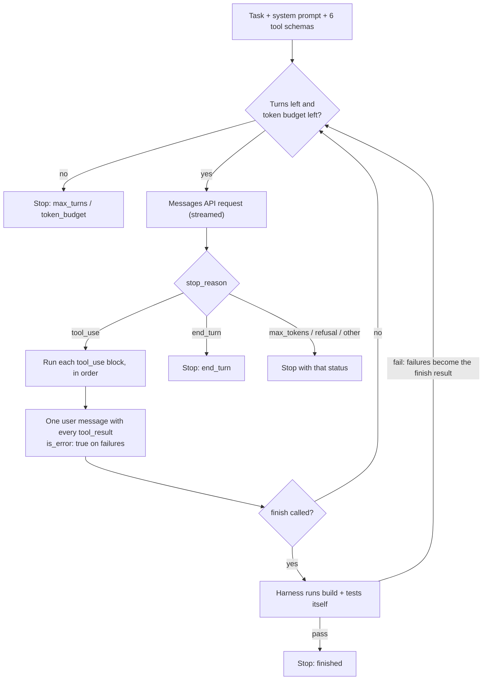

# xcfix

xcfix is an agent that fixes broken iOS builds and failing tests. This folder holds:

| File | What it is | Stage |
| --- | --- | --- |
| [`tools.py`](tools.py) | The six tools the model can call, their JSON schemas, and the code that runs them | 2 |
| [`agent.py`](agent.py) | The agent loop: system prompt, Messages API requests, tool execution, stop conditions, the harness's own build-and-test check, and prompt caching and context editing | 3, 4 and 6 |
| [`safety.py`](safety.py) | Edit guardrails, and git checkpoints with rollback | 5 |
| [`tracing.py`](tracing.py) | JSONL traces, per-model prices and cost, and the end-of-run summary | 7 |
| [`../evals/run_eval.py`](../evals/run_eval.py) | The mini eval: runs xcfix on every `bug/*` branch and writes the results tables | 8 |
| [`__main__.py`](__main__.py) | The command line: `python -m xcfix <project>` | 3 |

Tests are in [`../tests/`](../tests/).

The stages are the order xcfix was built in, and each later section names its stage:
1. The ListingsKit fixture and its seeded `bug/*` branches.
2. Tools.
3. The agent loop.
4. Harness verification.
5. Safety and rollback.
6. Efficiency.
7. Tracing.
8. The mini eval.

## Why not just use Claude Code?

For one developer fixing one bug, a prompt or Claude Code is the right tool. xcfix exists because a platform team needs something different.

Asked in a chat, Claude can only suggest a fix. It doesn't see the real compiler output, can't check that its fix compiles, and has no way to know when it's done. xcfix closes that loop: it runs the real build, gives Claude the real errors, lets it edit, rebuilds, and repeats until the code passes. The model brings the judgment; the harness brings the ground truth.

Five things a task-specific harness adds:

1. **Verification, not trust.** A chat answer looks right. xcfix shows it is right: when the model calls `finish`, the harness reruns the build and tests itself before accepting it. Across a 2,000-file migration, "looks right" means hundreds of broken PRs.
2. **Real context instead of pasted context.** In a chat, a person copies errors and files in. Here the model searches, reads exact line ranges and sees only the relevant errors, so it gets the right context automatically and with few tokens.
3. **Safety and control.** The agent can't run arbitrary commands, can't leave the project, and can only make exact edits. Failed runs are rolled back, and guardrails reject shortcuts such as deleting test assertions or adding `@unchecked Sendable`. A prompt can ask for that; only a harness can enforce it.
4. **Measurable results.** Every run logs turns, tokens, cost, latency and outcome. That answers "is this working, and is it getting better?", which is what optimizing execution time, token efficiency, reliability and quality requires.
5. **No human in the loop.** A chat needs someone typing. xcfix can run in CI at 3 a.m. on a broken build, or in parallel across a whole migration. That's the step from personal assistant to platform infrastructure.

All of this is built: verification (Stage 4), rollback and guardrails (Stage 5), and per-run metrics (Stages 6 and 7). On the mini eval, xcfix fixed 15 of 15 runs across five seeded bugs; see [Mini eval](#mini-eval-stage-8).

### "But Claude Code already runs this loop"

It does, and it's an excellent general-purpose harness; you'd use it, or the Claude Agent SDK, for much of this work. You build your own harness when you need what a general one doesn't give you:

- domain tools tuned to iOS build and test output;
- a definition of "done" you control;
- guardrails specific to your codebase;
- metrics in your own format;
- reproducible runs you can evaluate.

General harnesses do well across many tasks; a task-specific one does better in a narrow domain. Knowing when to build and when to reuse is the real decision.

### The short version

A prompt gives you a suggestion; xcfix gives you a verified fix. It connects Claude to the real compiler and test runner, so it works from ground truth instead of guessing, and the harness, not the model, decides when the job is done. Narrow tools, rollback and guardrails make it safe; per-run tokens, cost and success rate make it measurable. That's what lets it run unattended in CI or across a 2,000-file migration. For a one-off bug, use Claude Code; for automation at platform scale, use a harness you control.

## Why narrow tools instead of a shell

A single `run_command(cmd)` tool would work, but it is a poor fit for an agent:

- **Safety.** A shell can run `rm -rf`, push to git or read `~/.ssh`. These tools can only search, read and edit files inside the project, and build or test it.
- **Token cost.** A raw `xcodebuild` log is thousands of lines. `run_build` returns only the errors, at most 30 lines.
- **Reliability.** Every tool has one job, a strict input schema and a predictable output format, so the model makes fewer malformed calls and recovers faster when it does.

## The six tools

| Tool | Input | Returns | Limits |
| --- | --- | --- | --- |
| `search_code` | `pattern` (regex), optional `glob` | `path:line: text` per match | 50 matches; skips `.build`, `.swiftpm`, `.git`, `DerivedData`, `xcuserdata`, `Pods` |
| `read_file` | `path`, `start_line`, `end_line` | Numbered lines with a header such as `(lines 40-43 of 60)` | 200 lines per call; extra lines are clipped with a note saying where to continue |
| `edit_file` | `path`, `old_str`, `new_str` | `Edited <path> lines N-M.` | `old_str` must occur exactly once |
| `run_build` | none | `BUILD SUCCEEDED`, or `BUILD FAILED` plus `file:line:col: message` per error | 30 errors |
| `run_tests` | none | `TESTS PASSED`, `TESTS FAILED` plus each failing test and message, or the compiler errors if the build fails | 30 failures |
| `finish` | `summary` | A `FinishSignal` for the loop | Must not be empty |

### Example: a real fix on `bug/type-mismatch`

```text
>> run_build
BUILD FAILED
Sources/ListingsKitLive/ExpediaListingsService.swift:42:61: cannot convert value of type 'Int' to expected argument type 'String'
>> read_file  (path: .../ExpediaListingsService.swift, start_line: 40, end_line: 43)
Sources/ListingsKitLive/ExpediaListingsService.swift (lines 40-43 of 60)
40|             URLQueryItem(name: "checkIn", value: query.checkIn.formatted(day)),
41|             URLQueryItem(name: "checkOut", value: query.checkOut.formatted(day)),
42|             URLQueryItem(name: "room1.adults", value: query.adults)
43|         ]
>> edit_file  (old_str: "value: query.adults)", new_str: "value: String(query.adults))")
Edited Sources/ListingsKitLive/ExpediaListingsService.swift lines 42-42.
>> run_build
BUILD SUCCEEDED
```

## How `tools.py` is organized

The file has four sections, top to bottom:

1. **Limits and `ToolError`.** Constants such as `MAX_SEARCH_MATCHES` and `MAX_READ_LINES`, and the exception for failures the model can fix.
2. **The tool registry.** Each tool is a `Tools` method with a `@tool` decorator that holds its description and the JSON Schema of each parameter (see [The tool registry](#the-tool-registry) below).
3. **Output parsers.** Pure functions that turn raw `swift build`, `swift test` and `xcodebuild` output into short lists:
   - `parse_build_errors` keeps only lines that start with `file:line:col: error:`. Swift prints each error twice, the second time indented inside a source snippet, and the duplicate is dropped. XCTest assertion lines look like compile errors and are skipped here.
   - `parse_test_failures` reads Swift Testing's `✘ Test … recorded an issue at …` lines and XCTest's `file:line: error: -[Suite test] : …` lines.
4. **Execution.** `Tools` binds every tool to one project root:
   - `Tools.execute(name, args)` is the single entry point the loop calls. It looks the tool up in the registry, checks the arguments against its schema, then calls the method.
   - `BuildConfig` sets the build and test commands. The default is `swift build` / `swift test`; use `BuildConfig.xcodebuild(scheme, destination, workspace=..., project=...)` for an Xcode project.
   - `runner` runs shell commands. It is injected, so tests can swap in a fake one without running a compiler.

   After the class, `TOOL_SCHEMAS` (passed unchanged as the `tools` parameter of the Messages API) and `TOOL_NAMES` are built from the registry, in the order the methods are declared.

## The tool registry

Each tool is defined in exactly one place: its method. The decorator sits right on top of the code it describes:

```python
@tool(
    "Read a line range of a file inside the project. ...",
    path={"type": "string", "description": "File path relative to the project root, ..."},
    start_line={"type": "integer", "minimum": 1, "description": "First line to read (1-indexed)."},
    end_line={"type": "integer", "minimum": 1, "description": "Last line to read, inclusive. ..."},
)
def read_file(self, path: str, start_line: int, end_line: int) -> str:
    ...
```

When the module is imported, `@tool`:

- builds the `input_schema`, with `additionalProperties: false`;
- takes `required` from the method signature: a parameter without a default is required, so `glob: str | None = None` makes `glob` optional;
- raises `TypeError` if the schema properties and the method parameters differ, or if two tools share a name.

Without the registry, each tool would be defined three times: its schema, its entry in a dispatch table and its method signature. Renaming a parameter in one place but not the others would only show up when the model called the tool. With the registry, the same mistake stops the import.

Descriptions and parameter schemas stay hand-written instead of being generated from type hints. They are what most affects how well the model uses a tool, so they deserve full control.

To add a tool, write a method on `Tools` and decorate it. Nothing else needs to change.

## Error handling

Each kind of failure has its own path, so the loop can treat them differently.

| Situation | What the tool does | What the loop does |
| --- | --- | --- |
| The model made a fixable mistake: bad path, path outside the root, edit not found or ambiguous, unknown tool, wrong argument type | `ToolError` with a message that says how to fix it | Return it as a `tool_result` with `is_error: true` so the model retries |
| An edit breaks a guardrail, for example it deletes an assertion | `GuardrailViolation` (a `ToolError`); the file is not changed | The same as any `ToolError`, and it's counted in `guardrail_blocks` |
| The build or tests fail | A normal result starting with `BUILD FAILED` or `TESTS FAILED` | Return it as a normal `tool_result`; the failures are what the model works on |
| The machine is misconfigured, for example `swift` is not on PATH | `RuntimeError` | Stop the run; the model cannot fix it |
| A tool has a bug and raises anything else | The exception propagates | Return `Internal error in <tool>: …` with `is_error: true`, so one bad call doesn't kill the run |

Error messages are written for the model. For example, when `old_str` is not found but matches after removing whitespace, the message says `(whitespace differs: check indentation)` so the next attempt can succeed.

## Path safety

`Tools.resolve` handles every path argument. It joins the path to the project root, resolves `..` and symlinks, and rejects the result if it lands outside the root. That blocks `../secret.txt`, absolute paths such as `/etc/hosts`, and a symlink inside the project that points outside it. An absolute path that is inside the root is allowed.

## The agent loop (Stage 3)

[`agent.py`](agent.py) is a hand-written loop over the Messages API, with no agent framework. Writing it by hand keeps every decision visible: what is sent, when tools run, and why the run stops.



### One turn

1. **Check the limits.** If the run has made `max_turns` requests (default 25) or used `token_budget` tokens (default 500,000), stop.
2. **Send the request.** The system prompt, `TOOL_SCHEMAS` and the whole conversation so far.
3. **Append the response** to the history as an assistant message, all of its content unchanged. That includes `thinking` blocks, which the API requires back exactly as it sent them.
4. **If `stop_reason` is `tool_use`,** run every `tool_use` block and send all the results back in **one** user message, each `tool_result` matched to its call by `tool_use_id`. A failed call gets `is_error: true` and a message saying what to change, so the model can recover on the next turn.
5. **Decide whether to stop**, using the table below. Otherwise, go back to step 1.

### Stop conditions

`Agent.run()` returns a `RunResult` whose `status` says why the run ended:

| `status` | When | `summary` |
| --- | --- | --- |
| `finished` | The model called `finish` **and** the harness's own build and tests passed | The model's summary of the fix |
| `end_turn` | The model ended its turn without calling a tool | The model's final text |
| `max_turns` | 25 requests without `finish` | Why it stopped |
| `token_budget` | Tokens used reached the budget, checked before each request | Tokens used and the budget |
| `max_tokens` | A response was cut off at `max_tokens` | Why it stopped; its tool calls were **not** run |
| `refusal` | The model declined, and the fallback model did too | The refusal category |
| `unexpected_stop` | Any other `stop_reason` | The value received |

The result also carries `turns`, the total `usage`, a per-turn `log` (stop reason, tools called, tool errors, tokens, `finish` verdict), the full `messages` history, and the verification fields described in [Harness verification](#harness-verification-stage-4).

### Request settings

| Setting | Value | Why |
| --- | --- | --- |
| Model | `claude-sonnet-5-5` | The plan's main model; change it with `--model` |
| Thinking | `{"type": "adaptive"}` | The model decides how much to reason before each step |
| Effort | `medium` | The suggested starting point for agentic coding on Sonnet 5.5; the mini eval can compare levels with `--effort` |
| `max_tokens` | 32,000 | Thinking counts toward it, so a small value would cut off turns |
| Streaming | `client.beta.messages.stream(...)` + `get_final_message()` | A large `max_tokens` can exceed the HTTP timeout on a non-streamed request |
| Fallbacks | `fallbacks="default"` (beta `server-side-fallback-2026-07-01`) | If a safety classifier declines a request by mistake, the API retries it on a fallback model instead of failing the run. Turn it off with `--no-fallbacks` |
| Retries | `max_retries=4` | The SDK retries rate limits, server errors and dropped connections |
| Prompt caching | `cache_control` on the system prompt + top-level automatic `cache_control` | Earlier turns are read from the cache at about 0.1× the price; see [Efficiency](#efficiency-stage-6) |
| Context editing | `clear_tool_uses_20250919` (beta `context-management-2025-06-27`) | The server clears stale build and test output in long runs; see [Efficiency](#efficiency-stage-6) |

### Design decisions

- **Calls in one turn run one by one, in the order the model listed them.** Running them in parallel would save little time, and an `edit_file` racing a `run_build` would build half-edited code. The system prompt tells the model about this order, so "edit, then build" in one turn works.
- **All results go back in one user message.** Splitting parallel results across several messages teaches the model to stop making parallel calls.
- **Tool errors don't end the run; harness errors do.** A `ToolError` or a tool bug becomes an `is_error` result the model can react to. A `RuntimeError`, such as a missing Swift toolchain, stops the run, because no edit can fix it.
- **A truncated response runs no tools.** When `stop_reason` is `max_tokens`, the last `tool_use` block may be incomplete, for example an `edit_file` with half of `new_str`. Running it could write broken code, so the run stops.
- **The `finish` result stays in the history.** When `finish` is called, its `tool_result` is still appended. That keeps the conversation valid, so a rejected `finish` can carry the verification failures and the run can continue (Stage 4).
- **The token budget counts everything.** That's uncached input, cache reads, cache writes and output across all turns. It's checked before each request, so a run can go over by at most one turn.
- **The system prompt and tool list never change during a run.** No timestamps, no per-run values. That keeps the request prefix identical from turn to turn, which Stage 6's prompt caching needs.

## Harness verification (Stage 4)

The model never decides success on its own. Calling `finish` is a request to stop, not a verdict: the harness runs the build and tests itself and accepts `finish` only if both pass.

Without this, a run would end whenever the model *believed* it was done. Models sometimes declare victory early: they fix the first compiler error and miss the next one, or never run the tests. In a single chat, a person catches that. Across an unattended migration of 2,000 files, nobody does, and each false "done" becomes a broken PR.

### How it works

When a turn contains a `finish` call:

1. **Every call in the turn runs first**, in order, including any listed after `finish`. An edit sent in the same turn as `finish` is therefore part of what gets checked.
2. **The harness runs `run_build`, then `run_tests`.** It uses the same tools and output parsers the model uses, so the model sees failures in a format it already knows. If the build fails, the tests are skipped: they couldn't compile anyway.
3. **If both pass,** the `finish` result becomes `Verified by the harness: BUILD SUCCEEDED, TESTS PASSED.` The run stops with status `finished`, and the model's summary becomes the result's `summary`.
4. **If either fails,** the `finish` result is replaced with the real failures, marked `is_error: true`:

   ```text
   Not accepted. The harness ran the build and tests itself, and they do not pass yet:

   BUILD SUCCEEDED
   TESTS FAILED
   mapsHotelsToListings() at ExpediaListingsServiceTests.swift:36:9: Expectation failed: (first.starRating → 5.0) == 0.0

   Keep working, and call finish again once run_build and run_tests both pass.
   ```

   The loop continues with the next turn. The rejection costs one turn, so `max_turns` and the token budget still bound a model that keeps calling `finish` too early.

That example is real output: a scripted model called `finish` right away on the `bug/failing-test` branch, and the harness turned it down with the actual Swift Testing failure.

### Every run ends with a verdict

Verification isn't only for `finish`. Whatever the reason a run stops (`end_turn`, `max_turns`, `token_budget`, a refusal), the harness checks the code one last time. If no tool has run since the latest check, that result is reused rather than run again. So `RunResult` always says whether the code really passes:

| Field | Meaning |
| --- | --- |
| `verified` | `True` if the harness's last build-and-test check passed, whatever the `status` |
| `verification` | The output of that check, such as `BUILD SUCCEEDED\nTESTS PASSED` or the failures |
| `finish_rejections` | How many times the model called `finish` while the build or tests still failed |
| `log[n].verification` | `"passed"` or `"rejected"` on turns where the model called `finish`, otherwise `None` |

`status` says how the run ended; `verified` says whether it worked. They can disagree: a model that fixes the bug and then ends its turn without calling `finish` gets status `end_turn` with `verified: True`. The CLI's exit code and the mini eval use `verified`, never the model's claim.

`finish_rejections` is a useful metric in its own right. A high count means the model declares success too early, which the prompt or the effort level can address.

### Edge cases

- **The check itself fails to run.** A timeout (`ToolError`) or an unexpected error, such as `OSError`, counts as "not verified" with the error as the report; it never counts as a pass. A missing toolchain (`RuntimeError`) still stops the run, as it does for tool calls.
- **Several `finish` calls in one turn.** Only the last valid one is checked; earlier ones get `Ignored: a later finish call in this turn is the one checked.`
- **An invalid `finish`**, such as one with an empty summary, is an ordinary `ToolError` and triggers no check.

### Limits

Verification proves the build and tests pass. It doesn't prove the fix is *right*: a model could still make the tests pass by deleting an assertion or adding `@unchecked Sendable`. Stage 5's guardrails close that gap by rejecting those edits.

## Safety and rollback (Stage 5)

Verification answers "does it pass?". Safety answers two other questions: "did it pass *honestly*?" and "what's left behind when a run fails?". [`safety.py`](safety.py) handles both:

- **Guardrails** reject edits that would make the build or tests pass the wrong way.
- **Git checkpoints** record the project before the run and after every green build. A run that isn't verified is rolled back to the baseline.

Without these, an unattended agent fails in two dangerous ways. It can "fix" a failing test by deleting it, which verification alone would accept. Or it can stop halfway and leave a project with three half-applied edits for someone to clean up. A prompt can ask the model not to do these things; only a harness can make sure.

### Guardrails

Every `edit_file` call is checked before the file is written. A rule compares the text the edit removes (`old_str`) with the text it adds (`new_str`):

| Rule | Rejected when the edit… | Patterns counted |
| --- | --- | --- |
| Keep assertions | removes any | `#expect(`, `#require(`, `XCTAssert…(`, `XCTFail(` |
| Keep tests | removes any | `@Test`, `func test…(` |
| Don't disable tests | adds any | `.disabled(`, `withKnownIssue`, `XCTSkip…`, `XCTExpectFailure` |
| Don't silence concurrency checks | adds any | `@unchecked Sendable`, `nonisolated(unsafe)` |
| No placeholders | adds any | `TODO`, `FIXME` |

Details that matter:

- **Commenting out counts as deleting.** The first four rules ignore matches inside comments, so `// #expect(a == 1)` no longer counts as an assertion. The placeholder rule does look inside comments, since that's where a `// TODO` lives.
- **It counts, it doesn't ban.** Changing an expected value, `#expect(x == 0.0)` to `#expect(x == 5.0)`, keeps the count the same and is allowed. That's the legitimate fix when the test itself is wrong, as on `bug/failing-test`. Removing an existing `@unchecked Sendable` or editing near an existing `TODO` is fine too.
- **The model learns the rules up front.** The `edit_file` description lists them, so the model doesn't have to find them by being rejected.
- **A rejection is a normal tool error.** The file is untouched, the `tool_result` is `is_error: true` with advice on what to do instead, and the run continues:

  ```text
  Edit rejected by guardrail: it removes 1 test assertion(s) (#expect, #require, XCTAssert, XCTFail).
  Fix the code under test instead; if the test itself is wrong, change the expected value rather than
  deleting the assertion.
  ```

  `RunResult.guardrail_blocks` counts rejections. Like `finish_rejections`, a high number tells you the model is looking for shortcuts.

### Checkpoints

A checkpoint is a real git commit of the project directory, stored on a **private ref**, `refs/xcfix/<run-id>`, never on your branch:

| When | Message |
| --- | --- |
| Before the first request | `xcfix: baseline before the run` |
| After every build that succeeds: a `run_build`, a `run_tests` that got past compiling, or the harness's own verification build | `xcfix: build succeeded (<tool>, turn N)` |
| When the run ends verified | `xcfix: verified` |

How it works:

- **It takes snapshots without touching your work.** Each snapshot uses a temporary git index: `git add --all` of the project directory, then `git write-tree` and `git commit-tree`. Your branch, `HEAD`, the staging area and files outside the project are never touched. Untracked files are included, so uncommitted work in progress is protected too. Ignored files such as `.build/` are skipped.
- **The checkpoints form a chain.** Each one's parent is the previous one, so `git log refs/xcfix/<run-id>` reads as the run's history. A snapshot identical to the last one is skipped, so rebuilding without edits doesn't add commits.
- **Checkpoints use their own identity.** They're authored by `xcfix <xcfix@localhost>`, so they work on machines with no `user.name` set and are never mistaken for your commits.

Why not commit on the branch? It would add harness commits to your history. Worse, `git add -A` would sweep up any unrelated uncommitted change in the repository.

### Rollback

| How the run ends | What happens to the project |
| --- | --- |
| `verified` | The fix stays in the working tree, uncommitted, for you to review and commit. The final state is checkpointed |
| Not verified, whatever the `status` | Restored to the baseline (`rolled_back: true`) |
| An exception: API error, missing toolchain, Ctrl-C | Restored to the baseline, then the exception is re-raised |

Rollback restores every file from the baseline checkpoint with `git restore --source=<baseline> --worktree`, and deletes files created during the run. A failed run therefore leaves the project exactly as it found it, so rerunning it is safe. That matters for the mini eval, which runs xcfix on branch after branch, and for unattended runs in CI.

Rolling back doesn't discard the work. The ref keeps every green-build checkpoint from the failed run, so you can inspect or recover partial progress:

```bash
git log --oneline refs/xcfix/<run-id>              # the run's checkpoints
git diff <baseline-sha> <checkpoint-sha>            # what the model changed by that point
git restore --source=<checkpoint-sha> --worktree -- 01-agent-loop/fixtures/ListingsKit
git for-each-ref --format='%(refname)' refs/xcfix | xargs -n1 git update-ref -d   # delete all xcfix refs
```

`RunResult` reports `checkpoint_ref`, the list of `checkpoints` (sha, tree, message) and `rolled_back`. The verification fields describe the code *before* any rollback, which is the state the model produced.

### Tested on the real repo

A scripted model ran against `bug/failing-test`:

1. **It tried to delete the failing assertion.** The guardrail blocked it: `guardrail_blocks: 1`.
2. **It changed the expected value instead.** The run was verified, with checkpoints `baseline` → `build succeeded (run_tests, turn 2)`.

A second run made a wrong edit and gave up. It was rolled back, and `git status` came out byte-for-byte what it was before the run.

### Turning it off

`--no-checkpoints` (or `Agent(..., checkpoints=False)`) skips checkpoints and rollback. You need it outside a git repository: without it, a project outside one stops the run at the start with `git rev-parse failed`. The guardrails can't be turned off.

## Efficiency (Stage 6)

Every turn resends the whole conversation: system prompt, six tool schemas, and every earlier message and tool result. By turn 15 the model is re-reading turns 1 to 14 for the fifteenth time. This stage attacks that cost three ways:
- **Cache** what repeats.
- **Clear** old build output once it's stale.
- **Measure** every turn so the gains show up in numbers.

### 1. Prompt caching on the system prompt and tool definitions

A cached prompt prefix is billed at about **0.1×** the input price when read, and 1.25× when first written. Caching is a byte-for-byte prefix match over `tools` → `system` → `messages`, in that order, so the request has two breakpoints:

| Breakpoint | Where | What it caches |
| --- | --- | --- |
| Explicit | `cache_control` on the system prompt's text block | The tool schemas and the system prompt, which render before it. They're identical on every request of every run, so even turn 1 of the *next* run reads them |
| Automatic | top-level `cache_control` on the request | Everything up to the last block. The API moves it forward each turn, so turn N reads turns 1 to N−1 from the cache and writes only what the last turn added |

This is the combination the docs recommend for agent loops: a guaranteed read point for the static prefix, plus a moving one for the growing conversation.

Caching only works if the prefix never changes, so the code keeps it stable on purpose:
- **No dynamic values:** the system prompt has no timestamps, run IDs or paths.
- **Fixed tool list:** `TOOL_SCHEMAS` is built once, in declaration order.
- **Fixed settings:** model, thinking and effort stay the same for the whole run.
- **Append-only history:** earlier messages are never edited (see section 2).

A test asserts that each request's `system`, `tools` and settings are byte-identical to the previous request's, and that its history extends the previous one without changing it.

**TTL.** The default is a 5-minute TTL, and every cache read refreshes it. That covers normal turns, where a model response plus a `swift build` takes well under 5 minutes. For a large Xcode project, where one build or test run can take longer, use `--cache-ttl 1h`. The 1-hour TTL doubles the write price, but it avoids rewriting the whole conversation after each slow build.

**Minimum size.** Sonnet 5.5 caches prefixes of 512 tokens or more. The tools and system prompt alone are about 1,300 tokens, so caching works from the first request.

### 2. Old build logs: cleared on the server, never edited out of the history

The plan says to "truncate old build logs in history to their last error summary". Half of that is already done, and the other half is done differently on purpose.

**Build logs enter the history already summarized.** `run_build` and `run_tests` never return a raw log, only the parsed errors or failures, at most 30 lines (Stage 2). A 2,000-line `xcodebuild` log is stored as a few `file:line: message` lines from the start.

**Old summaries are cleared on the server, not rewritten in `messages`.** The obvious implementation is to edit old `tool_result` blocks in the local history before each request. Here, that would cause two problems:

- **It breaks the cache.** Caching is a prefix match, so editing turn 3 invalidates the cache for everything after it. You'd pay the write price again for the whole rest of the conversation on every request, trading cheap cache reads (0.1×) for expensive rewrites (1.25×).
- **It breaks the thinking blocks.** Sonnet 5.5 ties each thinking block to the exact conversation that came before it. Editing an earlier turn invalidates every later thinking block. On accounts created on or after 31 August 2026 the request is rejected with a 400; on older accounts the model silently loses that reasoning.

Instead, xcfix uses the API's **server-side context editing** (`clear_tool_uses_20250919`, beta `context-management-2025-06-27`). The server removes old tool results from the prompt the model sees and leaves a placeholder. This isn't an edit to the conversation you sent, so thinking blocks stay valid. The local history stays append-only.

| Setting | Value | Why |
| --- | --- | --- |
| What can be cleared | `run_build`, `run_tests` and `finish` results (`exclude_tools` lists the other three) | Build and test output goes stale as soon as the code changes. A rejected `finish` carries build and test output too. Code the model read (`read_file`, `search_code`) and edits it made (`edit_file`) are what it reasons from, so they're kept |
| `trigger` | 30,000 input tokens | Short runs, which are most runs, are never touched, so caching works uninterrupted |
| `keep` | the 3 most recent tool uses | The latest results stay visible |
| `clear_at_least` | 5,000 tokens | Clearing breaks the cache from the cleared point, so it only happens when it frees enough to pay for the cache rewrite |

The cost of being wrong is small. If the model needs a cleared result, it calls `run_build` again, which is incremental and cheap.

### 3. Tokens per turn

Each `TurnLog` keeps that turn's `usage`, split the way the API bills it:

| Field | Meaning |
| --- | --- |
| `usage.input_tokens` | Prompt tokens after the last cache hit, at full price |
| `usage.cache_read_input_tokens` | Prompt tokens read from the cache (about 0.1×) |
| `usage.cache_creation_input_tokens` | Prompt tokens written to the cache (1.25× at 5 minutes, 2× at 1 hour) |
| `usage.output_tokens` | Output, including thinking |
| `usage.prompt_tokens` | The full prompt size: the three input fields added together. `input_tokens` alone looks deceptively small once caching works |
| `usage.cache_hit_rate` | `cache_read / prompt_tokens` for that turn |
| `cleared_tokens` | Tokens context editing removed from that turn's prompt |

`RunResult.usage` holds the same fields summed over the run. The CLI prints them per turn and for the whole run:

```text
turn  1  tool_use   run_build  [prompt 2,140 (0% cached), out 310]
turn  2  tool_use   read_file  [prompt 2,630 (81% cached), out 190]
turn  3  tool_use   edit_file, run_build  [prompt 3,410 (77% cached), out 420]
```

In a healthy run, the cached share climbs turn by turn: each request reads the whole earlier conversation and writes only the newest turn. If `cache_read_input_tokens` stays at 0 from turn 2 onward, something in the prefix is changing between requests. Diff two consecutive request bodies to find it. The token budget still counts every prompt token, cached or not, because it caps how much the run reads, not what it costs. Tracing (Stage 7) turns these numbers into dollars.

### Measuring the gains

Each optimization can be switched off, so the mini eval can compare runs with and without it:

| Flag | `Agent(...)` argument | Effect |
| --- | --- | --- |
| `--no-cache` | `caching=False` | No cache breakpoints |
| `--cache-ttl 1h` | `cache_ttl="1h"` | One-hour cache lifetime |
| `--no-context-editing` | `context_editing=False` | Old build and test output is never cleared |

## Tracing (Stage 7)

The run summary tells you *whether* a run worked. A trace tells you *why*: which turn was slow, which call failed and with what arguments, where the tokens went, and whether the cache held. [`tracing.py`](tracing.py) writes one JSON line per turn, ends the file with a run summary line, and prints a summary on screen.

Traces are the raw material for evaluating and improving xcfix:
- the [mini eval](#mini-eval-stage-8) builds its results table from them;
- they set the baseline that every later optimization is measured against;
- comparing traces from before and after a change proves whether it helped;
- they're the input for debugging a slow, expensive or failing run.

### Where traces go

The CLI writes `traces/<run-id>.jsonl`, relative to the directory you run it from. Change the folder with `--trace-dir`, or turn tracing off with `--no-trace`. `traces/` is in `.gitignore`, so everyday runs don't fill the repo; the mini eval writes its traces to `evals/traces/`, which is committed, because the published results link to them. In Python, pass `Agent(..., trace_dir="traces")`; the library default is no trace.

- **One run ID everywhere.** The trace file and the checkpoint ref (`refs/xcfix/<run-id>`) share the same ID, so `traces/20261022-102042-9d181f.jsonl` and `git log refs/xcfix/20261022-102042-9d181f` describe the same run. IDs start with the date and time, so traces sort chronologically.
- **Written as it happens.** Each line is written and flushed as soon as its turn ends. If the run crashes or you press Ctrl-C, the trace still holds every finished turn, and its last line is a `run` record with `"status": "error"` and the exception.
- **Never inside the project.** `Agent` refuses a `trace_dir` inside the project directory. Checkpoints would snapshot the trace file, and a rollback, which happens precisely when a run fails, would erase the turns traced during the run.

### One line per turn

Every turn is one `"type": "turn"` object: the tool calls with their arguments, latency, input, output and cached tokens, and cost. This is line 3 of a real trace from `bug/type-mismatch`, where the model fixes the bug and runs the tests in one turn:

```json
{
  "type": "turn", "run_id": "20261022-102042-9d181f", "turn": 3,
  "model": "claude-sonnet-5-5", "stop_reason": "tool_use",
  "latency_s": {"model": 0.0, "tools": 13.285, "verification": 0.0},
  "tools": [
    {"name": "edit_file", "id": "t3",
     "input": {"path": "Sources/ListingsKitLive/ExpediaListingsService.swift",
               "old_str": "value: query.adults)", "new_str": "value: String(query.adults))"},
     "is_error": false, "latency_s": 0.001, "result_chars": 72,
     "result_preview": "Edited Sources/ListingsKitLive/ExpediaListingsService.swift lines 42-42."},
    {"name": "run_tests", "id": "t4", "input": {}, "is_error": false,
     "latency_s": 13.284, "result_chars": 12, "result_preview": "TESTS PASSED"}
  ],
  "tokens": {"input": 70, "cache_read": 2590, "cache_write": 0, "output": 260, "prompt": 2660, "cleared": 0},
  "cache_hit_rate": 0.9737, "cost_usd": 0.003258, "verification": null
}
```

That run drove the real Swift toolchain with a scripted model and no API key. So the tool latencies are real (13.3 s for `swift test`), while the model latency and token counts are scripted.

| Field | What it holds |
| --- | --- |
| `model` | The model that actually served the turn. A refusal fallback can differ from the requested model, and the cost follows the serving model |
| `latency_s.model` | Time for the API request, from sending it to the last streamed event |
| `latency_s.tools` | Sum of this turn's tool calls; each call also has its own `latency_s` |
| `latency_s.verification` | The harness's build-and-test check, on turns where the model called `finish` |
| `tools[].input` | The arguments exactly as the model sent them. Strings longer than 2,000 characters are clipped with `…[+N chars]`, so edits stay readable |
| `tools[].result_preview` | The first 300 characters of what the model got back, plus `result_chars` for the full length. For `finish`, this is the harness's verdict |
| `tokens` | The turn's request: uncached `input`, `cache_read`, `cache_write`, `output` (thinking included), `prompt` (the full prompt size) and `cleared` (context editing) |
| `cost_usd` | That request's cost in US dollars, or `null` for a model with no known price |
| `verification` | `"passed"` or `"rejected"` on `finish` turns, otherwise `null` |

### The run line

The last line is `"type": "run"`. It holds what the eval needs without re-adding the turns:
- `status`, `verified` and `summary`;
- `turns`, call counts by tool, `tool_errors`, `finish_rejections` and `guardrail_blocks`;
- run totals for tokens and `cache_hit_rate`;
- `cost_usd` and `duration_s`;
- the time split between model, tools and verification;
- `rolled_back`, `checkpoint_ref`, and the output of the final check.

### Cost

`cost_usd` prices each request from its `usage`, at that model's rates per million tokens:

| Model | Input | Output | Cache read | Cache write, 5-minute TTL | Cache write, 1-hour TTL |
| --- | ---: | ---: | ---: | ---: | ---: |
| `claude-sonnet-5-5` (default) | $2.00 | $10.00 | $0.20 | $2.50 | $4.00 |
| `claude-sonnet-5` (server-side fallback) | $2.00 | $10.00 | $0.20 | $2.50 | $4.00 |
| `claude-opus-5-5` | $4.00 | $20.00 | $0.20 | $5.00 | $8.00 |

A cache write costs 1.25× the input price on the 5-minute TTL and 2× on the 1-hour TTL. Thinking is billed as output. The prices are in the `PRICES` table in `tracing.py`, taken from Anthropic's pricing as of October 2026. Check them against the [pricing page](https://www.anthropic.com/pricing) before quoting costs, and add a row before using another model. A model missing from the table gets `cost_usd: null`, and the summary says `unknown` rather than showing a wrong number.

### The run summary

At the end, the CLI prints this. It's the summary from the `bug/type-mismatch` run above:

```text
── run 20261022-102042-9d181f ────────────────────
status       finished (verified)
summary      Converted query.adults to String.
turns        4   tool calls 5 (0 errors, 0 guardrail blocks, 0 finish rejections)
tokens       11,020   prompt 10,370 (76% from cache) · output 650
cost         $0.0143
time         31.7s   model 0.0s · tools 28.0s · verification 3.3s
tools        run_build ×1, read_file ×1, edit_file ×1, run_tests ×1, finish ×1
checkpoints  git log refs/xcfix/20261022-102042-9d181f
trace        traces/20261022-102042-9d181f.jsonl
```

Even with scripted model timings, the time line shows something useful: almost all of the run's 31.7 seconds were spent in `swift build` and `swift test`. With a real model, the `model` share appears next to it, and the trace shows which of the two to optimize.

### Reading traces

The lines are plain JSON, so ordinary tools work:

```bash
jq -c 'select(.type=="turn") | {turn, tools: [.tools[].name], cost_usd, cache_hit_rate}' traces/<run-id>.jsonl
jq -s 'map(select(.type=="run")) | map({run_id, status, verified, cost_usd, turns})' traces/*.jsonl
jq -c 'select(.type=="turn") | .tools[] | select(.is_error) | {name, input, result_preview}' traces/<run-id>.jsonl
```

The third command lists every failed call with the arguments that caused it. That's usually the first place to look when a run goes in circles.

## Mini eval (Stage 8)

The question every step so far leads up to: **does xcfix actually fix real Swift build and test failures, and at what cost?** [`../evals/run_eval.py`](../evals/run_eval.py) answers it by running xcfix on every seeded-bug branch and writing a results table.

### What the eval does

```bash
.venv/bin/python evals/run_eval.py                                  # 5 branches x 3 runs
.venv/bin/python evals/run_eval.py --runs 1 --branches bug/main-actor  # one branch, one run
```

For each branch in `bug/type-mismatch`, `bug/missing-import`, `bug/main-actor`, `bug/renamed-api` and `bug/failing-test`:

1. **Isolate.** Check the branch out into a temporary git worktree. Your checkout, your current branch and your uncommitted work are never touched, and the worktree is removed afterwards.
2. **Pre-check.** Build and test the *unmodified* fixture. It must fail, which proves the bug is really seeded; if it passes, the branch is skipped and reported. The pre-check also warms the SwiftPM build cache, so every run starts from the same state.
3. **Run xcfix 3 times.** The worktree is reset to the branch before each run, so runs are independent. Each run uses the normal settings (Sonnet 5.5, `medium` effort, caching and context editing on, checkpoints on) and writes its trace to `evals/traces/<run-id>.jsonl`.
4. **Keep the evidence.**
   - **Fixes:** a verified run's fix is saved as `evals/diffs/<run-id>.diff` for review.
   - **Refs:** the run's checkpoint ref is deleted, since the diff and the trace are the record.
5. **Report.**
   - `evals/results.md`: a table by branch, a table of every run, and the pre-check failures.
   - `evals/results.json`: one record per run.

"Fixed?" is the harness's verdict, from its own build and test check at the end of the run, never the model's claim. Three runs per branch show whether a result is reliable or lucky.

Options: `--runs`, `--branches`, `--model`, `--effort`, `--max-turns`, `--no-cache`, `--no-context-editing`, `--out`, `--traces`. With `--no-cache --no-context-editing`, the same script produces the "before" side of an optimization comparison.

### Results

The eval ran on 2026-10-22 with Claude Sonnet 5.5 at `medium` effort, 3 runs per branch, caching and context editing on:

| Branch | Fixed? | Turns (mean) | Tokens (mean) | Cache hit | Cost (mean) | Seconds (mean) |
| --- | ---: | ---: | ---: | ---: | ---: | ---: |
| `bug/type-mismatch` | 3/3 | 5.0 | 14,989 | 97% | $0.0082 | 19.6 |
| `bug/missing-import` | 3/3 | 5.7 | 19,935 | 89% | $0.0150 | 22.2 |
| `bug/main-actor` | 3/3 | 5.0 | 15,960 | 92% | $0.0137 | 19.8 |
| `bug/renamed-api` | 3/3 | 6.0 | 22,573 | 84% | $0.0250 | 23.8 |
| `bug/failing-test` | 3/3 | 6.3 | 19,107 | 91% | $0.0141 | 22.2 |
| **All** | **15/15 runs, 5/5 branches every run** | **5.6** | **18,513** | **91%** | **$0.0152** (total $0.2284) | **21.5** |

The milestone was at least 4 of 5 bugs fixed; all 5 were fixed, on every run. Per-run rows with links to each trace are in [`../evals/results.md`](../evals/results.md).

**Are the fixes real?** A passing build doesn't prove a good fix, so all 15 diffs were compared with the seeded bugs:
- **`bug/type-mismatch`, `bug/missing-import` and `bug/failing-test`:** in every run, the exact inverse of the seeded change. On `bug/failing-test`, the model changed the expected value (`0.0` → `5.0`) and explained that the test, not the code, was wrong. Its rewrites avoided the guardrails, as they should.
- **`bug/renamed-api`:** the four stale test call sites moved to `loadListings(for:)`, the right fix for a renamed API.
- **`bug/main-actor`:** this is the one to discuss. In all 3 runs the model fixed the isolation error by **removing** the `@MainActor` cache, so the code is back to what it was before the bug was seeded. It's correct and simple, but it drops a cache instead of making it concurrency-safe, for example with an `OSAllocatedUnfairLock`. A stricter rubric, or a system-prompt rule such as "keep existing behavior, including caches", would turn this into a partial fix.

### What the traces show

Aggregated over the 15 traces (84 turns):

| Finding | Evidence | Implication |
| --- | --- | --- |
| Caching works across turns *and* runs | 240,044 prompt tokens read from the cache, 198 uncached. Every run's first turn read the 2,172-token tools-and-system prefix that earlier runs had cached | About 65% cheaper than the same tokens at full price ($0.23 instead of about $0.65) |
| Output is half the cost | Output $0.115 of $0.228; cache writes 28%; cache reads 21% | The next cost lever is output: effort level and response length |
| Time is shared by the model and the build | Model 51% (about 2.0 s per turn), tools 36% (`swift test` about 3.8 s, `swift build` about 1.5 s), verification 11% | On a large Xcode app, build time would dominate; build caching matters as much as the model |
| Error messages make retries succeed | The only 3 tool errors were `old_str occurs 2 times` on `bug/renamed-api`; each next edit succeeded | The Stage 2 error design pays off |
| The safety nets weren't exercised by these bugs | 0 `finish` rejections, 0 guardrail blocks, 0 rollbacks | They're covered by unit tests and scripted real-repo runs; harder bugs are needed to see them fire live |
| Parallel calls are common | 24 of 84 turns made several calls, for example `edit_file` with `run_tests` | Running calls in order matters: an edit and a test run often share a turn |
| Context editing never triggered | 0 tokens cleared; the largest run was about 22,600 tokens, below the 30,000 trigger | These short runs can't evaluate it; SwiftMigrator's longer runs will |

The most common path, taken on `bug/type-mismatch`, is the textbook loop: `run_build` → `read_file` → `edit_file` + `run_build` → `run_tests` → `finish`.

### What to optimize next

- **Skip redundant verification.** The harness's final check rebuilds and retests code the model had just tested, about 11% of wall time. When the harness itself ran `run_tests`, it passed, and no edit followed, that result is already ground truth and can be reused.
- **Fewer output tokens.** Run the eval at `low` effort and compare fix rate against cost.
- **Harder bugs.** These five are fixed in about 5 turns. Multi-file Swift 6 migrations, flaky tests and cascading errors would put the guardrails, the `finish` checks and context editing to work.

### Reproducing it

The eval needs `ANTHROPIC_API_KEY` in the environment and costs about $0.25 for 15 runs at the prices in `tracing.py`. It takes about 6 minutes, most of it Swift builds and model time. Results vary from run to run; that's why each branch runs three times.

## Usage

### Setup

From `01-agent-loop/`:

```bash
python3.12 -m venv .venv
.venv/bin/pip install -r requirements.txt
export ANTHROPIC_API_KEY=...   # or sign in once with `ant auth login`
```

`requirements.txt` pins exact versions of `anthropic` and `pytest`, and installs xcfix itself in editable mode (`-e .`). From then on, `import xcfix` works from any directory, and edits to the source take effect without reinstalling.

The package is defined in [`../pyproject.toml`](../pyproject.toml):
- **Contents:** only `xcfix/`. `tests/` and `fixtures/` stay project files and never ship.
- **Dependencies:** version ranges (`anthropic>=2.0,<3`); the exact pins live in `requirements.txt`.
- **Command:** it adds an `xcfix` command.

```text
01-agent-loop/
├── pyproject.toml     package definition: xcfix, its dependencies, the xcfix command
├── requirements.txt   pinned dev environment
├── xcfix/             the package (this folder)
├── tests/             tests for the package; not shipped
└── fixtures/          ListingsKit, the project xcfix is evaluated on
```

### Command line

```bash
.venv/bin/xcfix fixtures/ListingsKit     # or: .venv/bin/python -m xcfix fixtures/ListingsKit
```

It prints one line per turn, then the run summary described in [Tracing](#the-run-summary), and writes the trace to `traces/<run-id>.jsonl`. The per-turn lines look like this:

```text
turn  1  tool_use   run_build  [prompt 2,350 (0% cached), out 180, 14.7s, $0.0077]
turn  2  tool_use   read_file  [prompt 2,410 (98% cached), out 120, 0.0s, $0.0018]
turn  3  tool_use   edit_file, run_tests  [prompt 2,660 (97% cached), out 260, 13.3s, $0.0033]
turn  4  tool_use   finish  finish passed  [prompt 2,950 (98% cached), out 90, 3.3s, $0.0016]
```

The exit code is `0` when the harness verified the code (`verified`), `1` when it didn't, and `2` for an API or setup error. A run that isn't verified also prints the output of the final check. Options: `--model`, `--effort`, `--max-turns`, `--token-budget`, `--no-fallbacks`, `--no-cache`, `--cache-ttl`, `--no-context-editing`, `--no-checkpoints`, `--trace-dir`, `--no-trace`, `--task`. For an Xcode project, add `--scheme` with `--destination` and `--workspace` or `--xcodeproj`.

### From Python

```python
from xcfix.agent import Agent
from xcfix.tools import Tools

from xcfix.tracing import format_summary

result = Agent(Tools("fixtures/ListingsKit"), max_turns=15, trace_dir="traces").run()
print(result.status, result.verified, result.cost_usd, result.trace_path)
print(format_summary(result))
```

## Running the tests

From `01-agent-loop/`:

```bash
.venv/bin/pytest              # or: .venv/bin/python -m unittest
```

The tests use the standard library's `unittest`, so both runners work. Because xcfix is installed, they also work from any directory, for example `.venv/bin/pytest path/to/01-agent-loop/tests`.

There are 100 tests, and none of them calls the API or runs a compiler. The checkpoint tests run real `git` in temporary repositories.

- **[`test_tools.py`](../tests/test_tools.py) (30 tests):** the schemas and the registry's drift check, path escapes, search limits, read ranges, edit uniqueness, build and test parsing, and argument validation. The parser tests use excerpts of real output from the `bug/type-mismatch` and `bug/failing-test` branches.
- **[`test_safety.py`](../tests/test_safety.py) (17 tests):**
  - each guardrail, including commented-out assertions and the allowed cases: changing an expected value, removing `@unchecked Sendable`, mentions in comments, existing TODOs;
  - checkpoints: rollback of tracked, untracked and newly created files; the branch, index and ignored files left untouched; the ref chain; no duplicate snapshots; behavior outside a repository.
- **[`test_agent.py`](../tests/test_agent.py) (37 tests):** the loop, driven by a fake client that returns scripted responses, and a fake toolchain whose build fails while the seeded bug is in the source. Each test runs in a fresh git repository, so checkpoints are on. They cover:
  - parallel calls answered in one message, in order;
  - `is_error` results followed by a successful retry;
  - unknown tools, bad arguments and crashing tools;
  - harness verification:
    - `finish` rejected on a broken build and on failing tests;
    - build, then tests;
    - edits listed after `finish`;
    - a verdict on every stop;
    - checks that fail to run;
  - safety:
    - rollback after a failed run and after an exception;
    - checkpoints only on green builds;
    - guardrail rejections reaching the model;
    - checkpoints turned off;
  - efficiency:
    - the two cache breakpoints and the 1-hour TTL;
    - a cached prefix that is byte-identical across turns;
    - an append-only history, even with long build output;
    - which tools context editing may clear;
    - per-turn token accounting;
  - each stop condition;
  - the request shape: model, system prompt, tools, thinking, effort, fallbacks, and a plain request with every optional feature off.
- **[`test_eval.py`](../tests/test_eval.py) (4 tests):** the eval report: averages by branch and overall, errored runs counted as not fixed and left out of the averages, unknown costs, and the Markdown output.
- **[`test_tracing.py`](../tests/test_tracing.py) (12 tests):**
  - prices: 5-minute and 1-hour cache writes, a fallback model's rates, an unknown model;
  - trace files:
    - one line per turn plus a run line, with exact token and cost values;
    - tool arguments, errors and results;
    - clipping of long arguments;
    - a crash that still leaves the turns and an error line;
    - a `trace_dir` inside the project being refused;
  - the summary.

## Known limits

- `search_code` uses ripgrep when it is installed and a pure-Python search otherwise. The pattern is checked with Python's `re` in both cases, so the few patterns ripgrep accepts but Python rejects (such as `\p{L}`) are refused.
- Build and test commands time out after 600 seconds.
- The guardrails match patterns in text; they don't parse Swift. They catch the common shortcuts, not every one. A model could still weaken an assertion, for example `#expect(x == 5)` to `#expect(x >= 0)`, or add `try!` or a force cast, which only the system prompt discourages. Reviewing the final diff is still worth it.
- Rollback covers only the project directory. The tools can't write anywhere else, but a build script that writes outside the project wouldn't be undone.
- `refs/xcfix/*` refs build up over many runs. Delete them with the command in [Rollback](#rollback).
- The context-editing docs don't say whether `keep: 3` counts only the clearable tools or every tool call. If it counts every call, the latest build result can be cleared after three `read_file` calls; the model then reruns `run_build`. The trigger is set high enough that this rarely matters, and in the mini eval it never triggered; traces from longer runs will show whether it does.
- When context editing clears content, the cache is rewritten from that point. `clear_at_least` limits how often that happens, but a long run still pays for it once or twice.
- The cache is per workspace and model. Switching models or effort levels, even between runs, starts it cold.
- The sample trace and summary in [Tracing](#tracing-stage-7) come from a scripted model, so their token counts, cost and model latency are illustrative. The [Mini eval](#mini-eval-stage-8) numbers are from live API runs.
- The eval has five small bugs in one small package. 15/15 shows the loop works; it doesn't predict the fix rate on a large app or on harder failures.
- Cost is computed from the prices in `PRICES`, not read from the bill. If prices change, or a request is billed differently (for example, a refusal's billing depends on its category), the trace can be off until the table is updated.
- `latency_s.model` measures until the final streamed event, not time to the first token.
